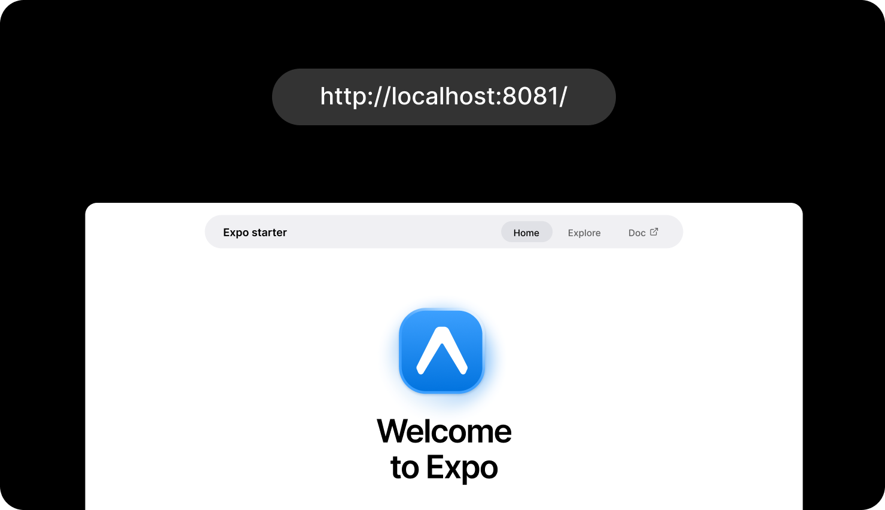

# Volares

<p align="center">
  
</p>

<h3 align="center">Sua próxima viagem começa aqui</h3>

<p align="center">
  Aplicativo mobile para buscar voos, visualizar aeronaves e pilotos, realizar reservas e acompanhar os tíquetes.
</p>

<p align="center">
  <a href="./Volares/README.md">
    
  </a>
  
  
  
</p>

---

## Demonstração

Adicione aqui o vídeo principal do aplicativo.

<!--
GitHub não reproduz um arquivo MP4 diretamente em Markdown.
Use uma das opções abaixo:

1. Faça upload do vídeo no GitHub e cole o link gerado:
<video src="./demo/volares.mp4" controls width="800"></video>

2. Ou adicione uma imagem clicável com o link do YouTube:
[](https://www.youtube.com/)
-->

<p align="center">
  
</p>

---

## Funcionalidades

| Buscar voos | Reserva completa | Meus tíquetes |
|---|---|---|
| Escolha origem, destino e data para encontrar opções disponíveis. | Visualize piloto, aeronave, passageiro, pagamento e informações do voo. | Consulte reservas confirmadas em uma experiência de tíquete. |

- Cadastro e autenticação de usuários
- Consulta de aeroportos e aeronaves
- Busca de voos por rota e data
- Filtros por melhor opção, menor preço e menor duração
- Seleção de quantidade de passageiros
- Pagamento demonstrativo por cartão, Pix ou milhas
- Comprovante de voo após a reserva
- Perfil do usuário
- Exclusão segura da conta
- Painel administrativo com Sanity

---

## Como o Volares funciona

1. O usuário cria uma conta ou entra com o email e a senha.
2. Escolhe origem, destino e data da viagem.
3. O aplicativo consulta o catálogo de voos e aeroportos.
4. Seleciona uma opção e confirma o passageiro.
5. Escolhe um método de pagamento.
6. O sistema gera o comprovante e a reserva.
7. O tíquete pode ser consultado na aba **Reservas**.

---

## Capturas do aplicativo

<p align="center">
  
</p>

<!--
Substitua os nomes abaixo pelas capturas reais do app:

| Tela inicial | Busca de voos | Comprovante |
|---|---|---|
|  |  |  |

| Reservas | Perfil | Painel administrativo |
|---|---|---|
|  |  |  |
-->

---

## Tecnologias

- Expo SDK 58
- React 19
- React Native 0.88
- Expo Router
- Supabase Auth
- Supabase Database
- Sanity CMS
- Next.js
- TypeScript

---

## Estrutura do projeto

```text
volares/
├── Volares/                # aplicativo Expo
│   ├── src/app/            # rotas
│   ├── src/components/     # telas e componentes
│   ├── src/lib/            # Supabase e Sanity
│   └── supabase/           # banco e Edge Functions
└── volastdio/
    ├── studio/             # Sanity Studio
    └── web/                # painel administrativo Next.js
```

---

## Executar o projeto

Requisitos: Node.js 20+, npm e conta no Expo.

```bash
git clone <LINK_DO_REPOSITORIO>
cd volares/Volares
npm install
npx expo start
```

O guia completo de instalação, configuração do Supabase e preparação do Sanity está em:

**[README de instalação do Volares](./Volares/README.md)**
