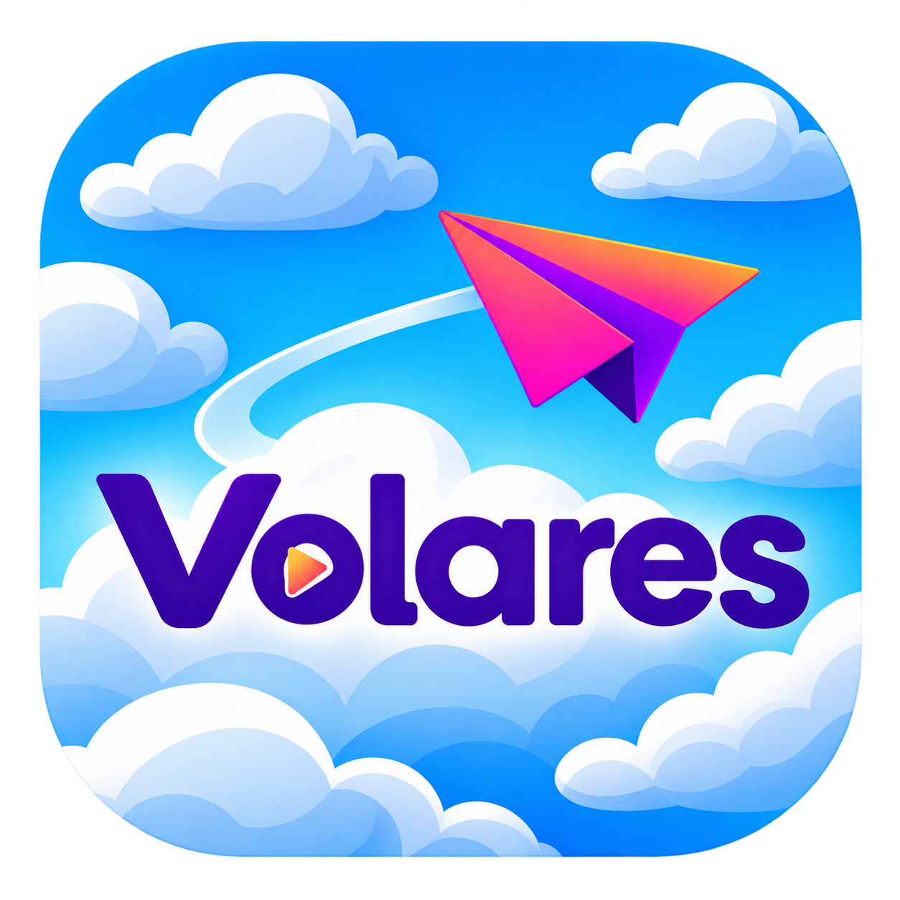
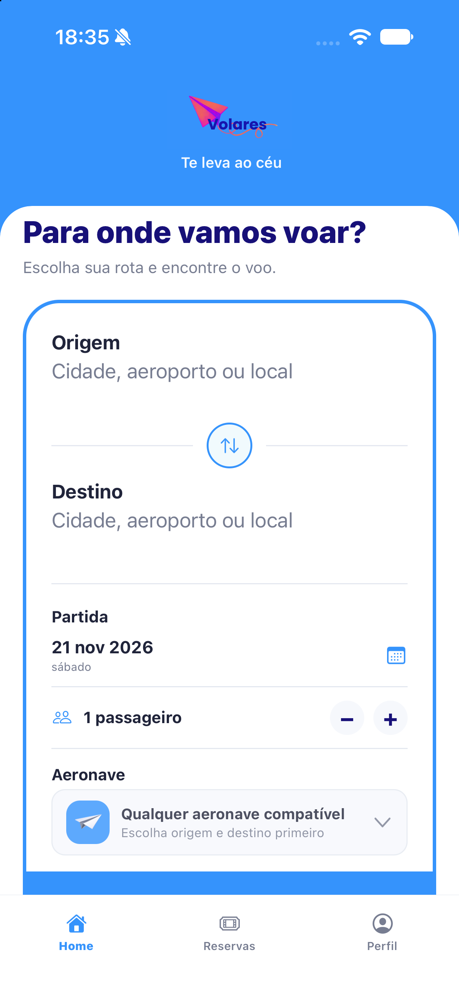
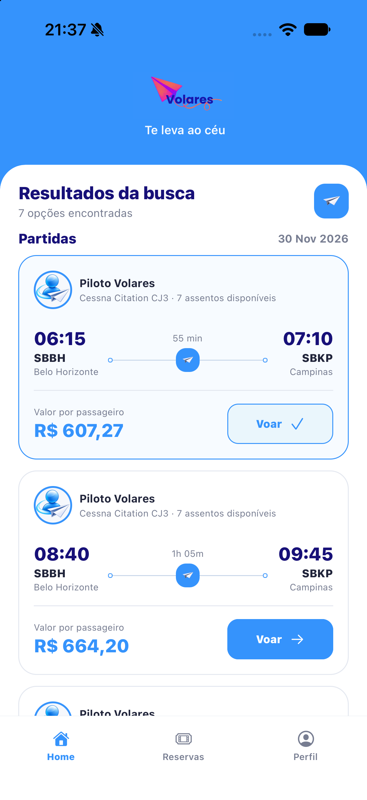
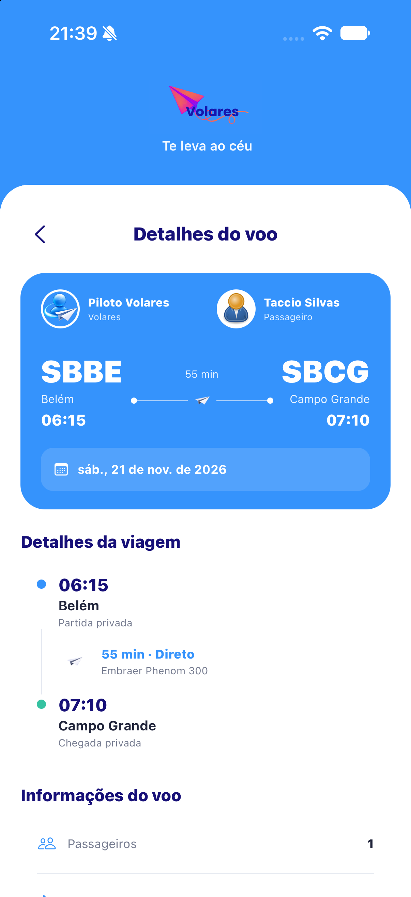
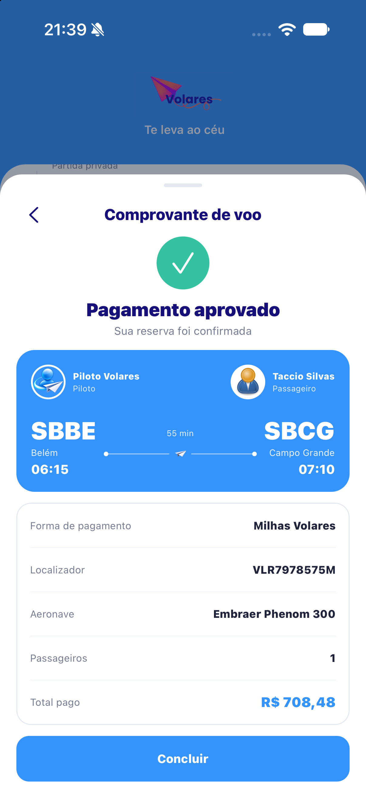
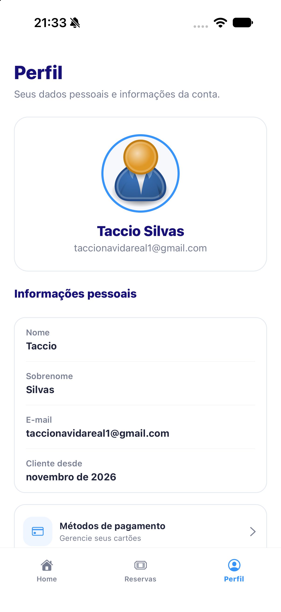

# Volares

<p align="center">
  
</p>

<p align="center">
  
</p>

<h2 align="center">Meu Projeto: Volares</h2>

<p align="center">
  A proposta do Volares é conectar pessoas com o mesmo destino, permitindo que pilotos
  ofereçam assentos disponíveis em suas aeronaves para compartilhar a viagem e o custo.
  Passageiros encontram opções compatíveis com sua origem e seu destino, visualizam
  piloto, aeronave, horário e preço e fazem a reserva diretamente pelo aplicativo.
</p>

<p align="center">
  <a href="./Volares/README.md">
    
  </a>
  <a href="./telasvolares/demo.mp4">
    
  </a>
</p>

---

## Apresentação do Volares: Seu app de viagens particular

O **Volares** é um aplicativo criado para facilitar a busca e a reserva de viagens aéreas.
A ideia apresentada une praticidade, organização e uma experiência visual mais humana:
o usuário escolhe a origem, o destino, a data e a quantidade de passageiros, compara as
opções disponíveis e conclui a reserva em poucos passos.

---

## Simulação do app

<p align="center">
  <a href="./telasvolares/demo.mp4">
    
  </a>
</p>

<p align="center">
  Clique na imagem ou no botão abaixo para assistir à demonstração do aplicativo.
</p>

<p align="center">
  <a href="./telasvolares/demo.mp4">
    
  </a>
</p>

---

## Como usar o aplicativo

| 1. Criar conta | 2. Entrar | 3. Buscar |
|---|---|---|
|  |  |  |

O primeiro contato com o Volares começa pelo cadastro ou login. Depois, o usuário define
a viagem informando cidade ou aeroporto de origem, destino, data, número de passageiros
e aeronave compatível.

| 4. Comparar resultados | 5. Ver detalhes | 6. Confirmar reserva |
|---|---|---|
|  |  |  |

Após a busca, o aplicativo apresenta as opções disponíveis. O passageiro pode visualizar
a rota, o horário, a duração, o piloto e os dados da aeronave antes de concluir o
pagamento. Em seguida, recebe um comprovante com o localizador da reserva.

---

## Minha conta e reservas

<p align="center">
  
</p>

Na seção **Perfil**, o usuário acompanha suas informações pessoais e pode encerrar a sessão.
Na seção **Reservas**, todos os voos confirmados podem ser consultados em formato de
tíquete, com partida, código do voo, quantidade de passageiros e total pago.

---

## Funcionalidades principais

- Cadastro e autenticação de usuários
- Pesquisa por origem, destino e data
- Seleção da quantidade de passageiros
- Compatibilidade com diferentes tipos de aeronave
- Comparação de opções de viagem
- Visualização de piloto, aeronave e duração
- Pagamento por cartão, Pix ou milhas
- Comprovante com localizador da reserva
- Tíquetes organizados na área de reservas
- Perfil do usuário
- Limpeza de reservas e exclusão da conta

---

## Experiência proposta

O Volares foi desenvolvido com foco em três pontos:

1. **Simples** — o usuário encontra a próxima viagem sem processos complicados.
2. **Visual** — rotas, horários e valores são apresentados de forma clara.
3. **Confiável** — piloto, aeronave, passageiro e comprovante ficam visíveis antes e depois da reserva.
4. **Agilidade e praticidade** - movimentar o mercado de táxi aéreo de uma forma mais prática.

---

## Tecnologias utilizadas

- Expo SDK 58
- React 19
- React Native 0.88
- Expo Router
- Supabase Auth
- Supabase Database
- Sanity CMS
- Next.js
- TypeScript

---

## Estrutura do projeto

```text
volares/
├── telasvolares/           # capa, capturas e vídeo da apresentação
├── Volares/                # aplicativo Expo
│   ├── src/app/            # rotas
│   ├── src/components/     # telas e componentes
│   ├── src/lib/            # integrações de dados
│   └── supabase/           # banco e Edge Functions
└── volastdio/
    ├── studio/             # Sanity Studio
    └── web/                # painel administrativo
```

---

## Executar o projeto

```bash
git clone <LINK_DO_REPOSITORIO>
cd volares/Volares
npm install
npx expo start
```

O processo completo de instalação e configuração está disponível no
[guia de instalação do Volares](./Volares/README.md).
